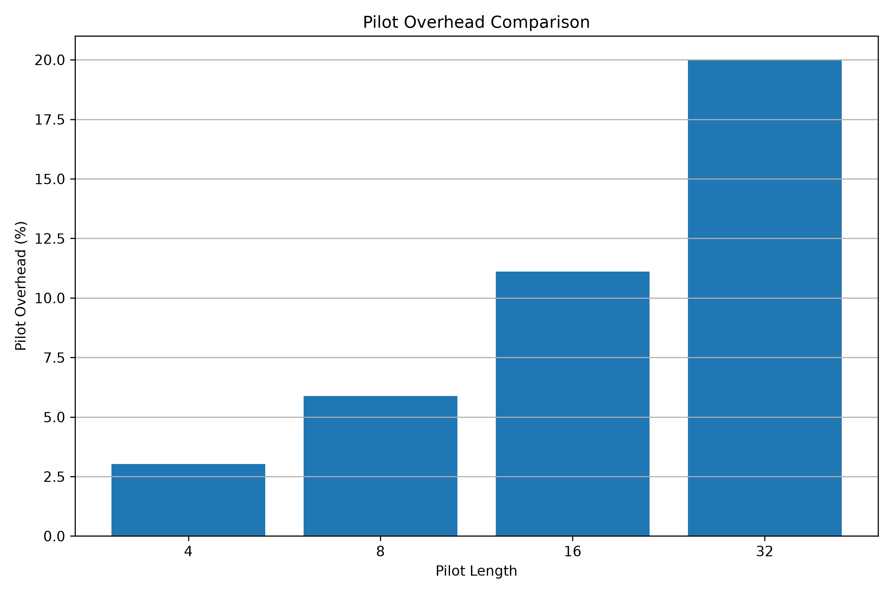
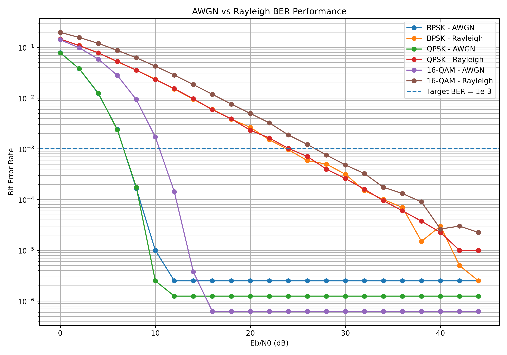
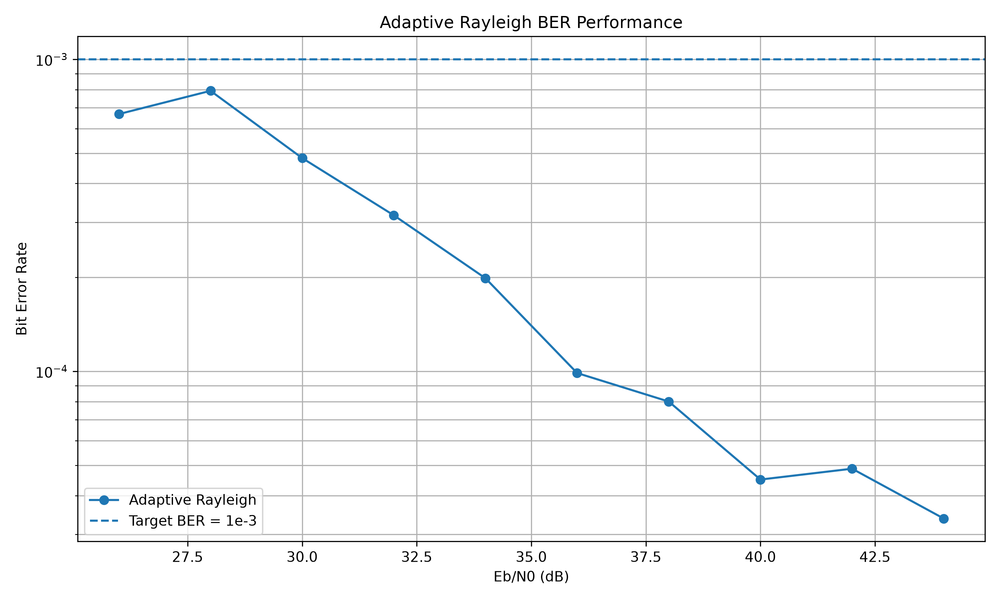
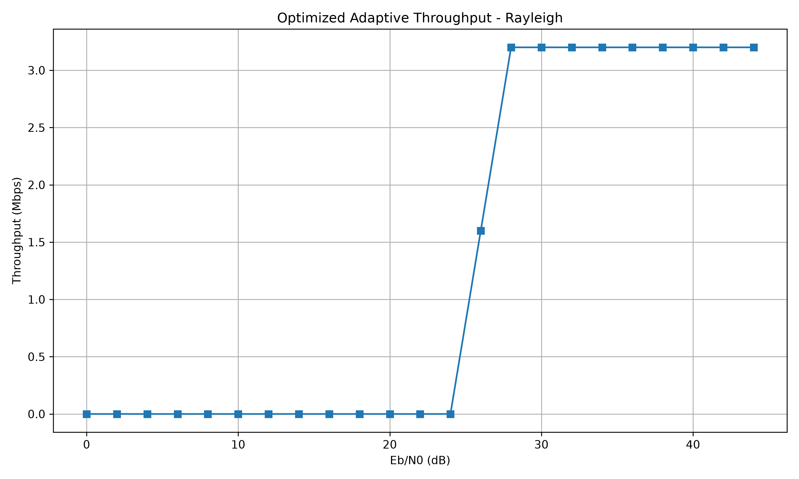
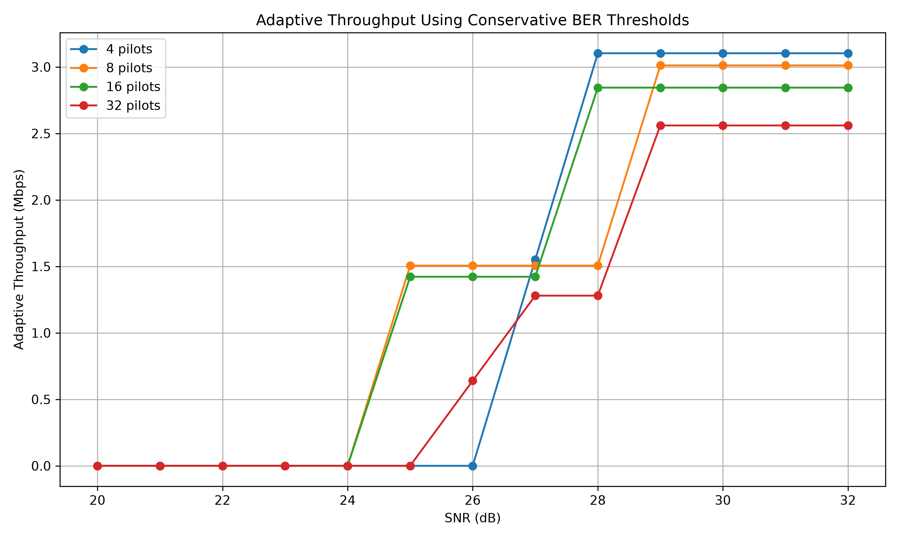
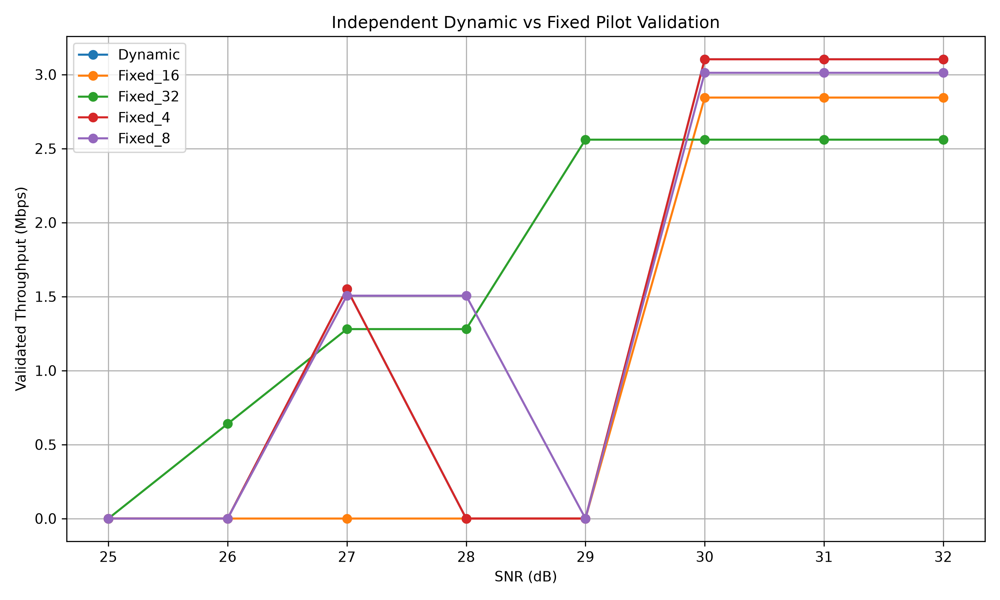
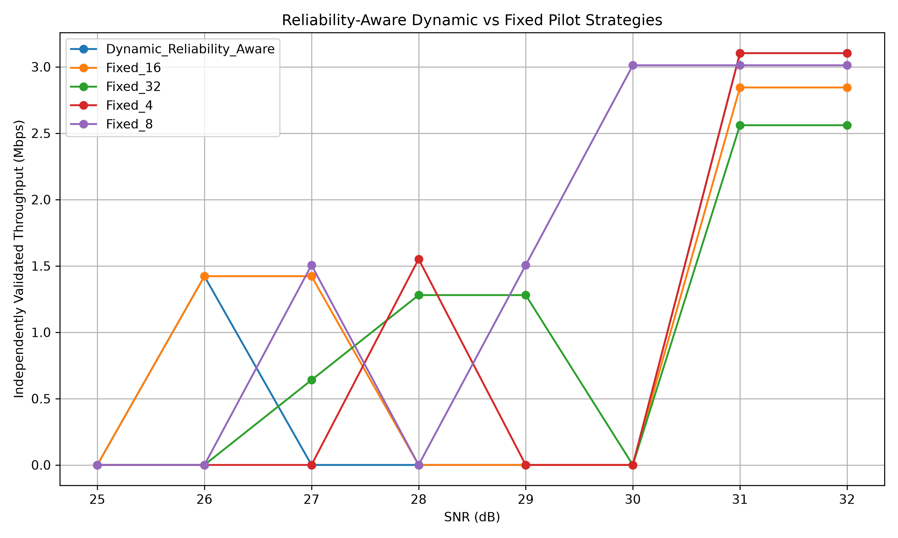

<div align="center">

# 📡 6G Adaptive Modulation & Pilot-Based Channel Estimation

### A Simulation-Based Study of BER, CSI, Pilot Overhead, and Adaptive Throughput


**Repository:** [Saiteja8466/6G-Adaptive-Modulation-Research](https://github.com/Saiteja8466/6G-Adaptive-Modulation-Research)

</div>

---

## 🌟 1. Project Overview

This repository contains a simulation-based research study of **adaptive digital modulation and pilot-based channel estimation** over wireless fading channels.

The study evaluates three modulation schemes:

- **BPSK** — 1 bit per symbol
- **QPSK** — 2 bits per symbol
- **16-QAM** — 4 bits per symbol

The main focus is to understand how modulation order, channel conditions, channel-state information (CSI), and pilot length influence:

- 📉 Bit Error Rate (BER)
- 📶 Channel-estimation performance
- ⏱️ Pilot overhead
- 🚀 Effective throughput
- 📊 Spectral efficiency
- 🛡️ Reliability and outage probability

The work is motivated by reliability and spectral-efficiency challenges relevant to future wireless systems, including 5G-Advanced and 6G research.

> **Research scope:** This is a simulation study relevant to 6G communication research. It is not a complete 6G physical-layer implementation, a standardized 6G system, or a real-world deployment evaluation.

## 🎯 2. Research Objectives

1. Evaluate BPSK, QPSK, and 16-QAM under different SNR conditions.
2. Compare AWGN and Rayleigh fading channel performance.
3. Investigate perfect and imperfect Channel State Information (CSI).
4. Implement Least Squares (LS) pilot-based channel estimation.
5. Study pilot lengths of 4, 8, 16, and 32 symbols.
6. Analyze the trade-off between pilot overhead and data throughput.
7. Develop and evaluate BER-constrained adaptive modulation strategies.
8. Compare fixed and dynamic pilot-selection strategies.
9. Perform multi-seed statistical validation and independent holdout testing.
10. Evaluate reliability and throughput together rather than relying only on theoretical throughput.

## 🧱 3. Communication System Model

### 3.1 Modulation Schemes

| Modulation | Bits per symbol | Main characteristic |
|---|---:|---|
| BPSK | 1 | Lower-order reference modulation |
| QPSK | 2 | Higher nominal rate than BPSK |
| 16-QAM | 4 | Higher nominal rate with greater reliability demands |

Higher-order modulation carries more bits per symbol, but its reliable operation depends on signal quality and channel-estimation accuracy.

### 3.2 Channel Models

**AWGN channel**

The Additive White Gaussian Noise model is used as a reference channel to study the effect of additive Gaussian noise.

**Rayleigh fading channel**

Rayleigh fading is used to represent a multipath propagation environment without a dominant line-of-sight component.

The pilot-based experiments use a simplified block-Rayleigh model:

\[
h \sim \mathcal{CN}(0,1)
\]

One complex channel coefficient is held constant over the pilot and data symbols within each block.

### 3.3 Channel State Information (CSI)

The research investigates three CSI conditions:

- **Perfect CSI:** The receiver uses the actual channel coefficient.
- **Imperfect CSI:** The receiver uses a channel estimate containing an artificial estimation error.
- **Pilot-based LS CSI:** The receiver estimates the channel from known pilot symbols.

The simplified imperfect-CSI sensitivity model uses:

\[
\hat{h}=h+e
\]

where \(e\) represents an artificial estimation-error term. This sensitivity model is distinct from the practical pilot-based LS estimator.

## 📡 4. Pilot-Based LS Channel Estimation

Known pilot symbols are transmitted so that the receiver can estimate the channel before equalizing the data.

The Least Squares (LS) estimator is:

\[
\hat{h}_{LS} =
\frac{\sum_{k=1}^{N_p}x_{p,k}^{*}y_{p,k}}
{\sum_{k=1}^{N_p}|x_{p,k}|^2}
\]

For unit-amplitude pilots, the estimate is the average of the received pilot samples.

### Pilot-length configurations

| Pilot symbols (\(N_p\)) | Data symbols (\(N_d\)) | Pilot overhead |
|---:|---:|---:|
| 4 | 128 | 3.03% |
| 8 | 128 | 5.88% |
| 16 | 128 | 11.11% |
| 32 | 128 | 20.00% |

Pilot overhead is calculated as:

\[
\text{Pilot Overhead} =
\frac{N_p}{N_p+N_d}\times100\%
\]

A longer pilot sequence uses more transmission resources. The research therefore investigates the trade-off between pilot resources, estimation reliability, and data throughput.

### 📊 Pilot overhead comparison



## ⚙️ 5. Simulation Parameters

The following are the nominal settings used in the pilot-based experiments. Individual scripts may use different settings, sample counts, or channel assumptions.

| Parameter | Value |
|---|---|
| Modulation schemes | BPSK, QPSK, 16-QAM |
| Pilot-based channel | Block Rayleigh fading |
| Channel estimation | Least Squares (LS) |
| Pilot lengths | 4, 8, 16, 32 symbols |
| Data block length | 128 symbols |
| Target BER | \(10^{-3}\) |
| Bandwidth | 1 MHz |
| Roll-off factor | 0.25 |
| Code rate | 1 |

The pilot-based scripts use the noise-variance convention:

\[
\sigma_n^2 =
\frac{1}{m\cdot 10^{\gamma_{\mathrm{dB}}/10}}
\]

where \(m\) is the number of bits per modulation symbol and \(\gamma_{\mathrm{dB}}\) is the SNR input used by the script. The exact SNR and noise normalization must be checked before comparing numerical thresholds across different scripts.

## 🚀 6. Throughput and Spectral Efficiency

The nominal symbol rate is calculated as:

\[
R_s=\frac{B}{1+\alpha}
\]

Pilot-aware throughput is calculated as:

\[
T =
R_s\,m\,r_c
\frac{N_d}{N_d+N_p}
\]

where:

- \(B\) is the nominal bandwidth.
- \(\alpha\) is the roll-off factor.
- \(m\) is the number of bits per modulation symbol.
- \(r_c\) is the code rate.
- \(N_d\) is the number of data symbols.
- \(N_p\) is the number of pilot symbols.

The study distinguishes nominal throughput from **validated throughput**. A selected configuration contributes validated throughput only when it passes the applicable BER acceptance criteria.

## 🧪 7. Experiments Performed

| No. | Experiment | Purpose |
|---:|---|---|
| 1 | Modulation comparison | Compare BPSK, QPSK, and 16-QAM BER |
| 2 | AWGN vs. Rayleigh | Study the effect of fading |
| 3 | Perfect vs. imperfect CSI | Investigate channel-estimation errors |
| 4 | Pilot-based LS estimation | Estimate the channel using known pilots |
| 5 | Pilot-length optimization | Compare 4, 8, 16, and 32 pilot symbols |
| 6 | Multi-seed validation | Analyze BER variability and confidence bounds |
| 7 | Conservative threshold analysis | Establish BER-based pilot/modulation thresholds |
| 8 | Targeted BPSK validation | Extend selected BPSK SNR tests |
| 9 | Fixed vs. dynamic selection | Compare pilot-selection strategies |
| 10 | Independent dynamic validation | Test selected strategies with fresh seeds |
| 11 | Reliability-aware selection | Use selection and separate holdout stages |

### 📉 AWGN and Rayleigh BER comparison



### 📈 Adaptive BER result



### 🚀 Adaptive throughput result



### 📊 Multi-seed statistical throughput



## 📋 8. Selected Experimental Results

### 8.1 Independent dynamic-system validation

The independent dynamic-system validation experiment reported:

| Strategy | Average throughput (Mbps) | Maximum throughput (Mbps) | Outage |
|---|---:|---:|---:|
| Dynamic | 1.358 | 3.103 | 50.0% |
| Fixed 4 pilots | 1.358 | 3.103 | 50.0% |
| Fixed 8 pilots | 1.506 | 3.012 | 37.5% |
| Fixed 16 pilots | 1.067 | 2.844 | 62.5% |
| Fixed 32 pilots | 1.680 | 2.560 | 12.5% |

In this experiment, fixed 32-pilot selection produced the highest average validated throughput.



### 8.2 Reliability-aware selection and holdout validation

A subsequent two-stage experiment used one seed range for configuration selection and a separate seed range for holdout validation.

| Strategy | Average throughput (Mbps) | Maximum throughput (Mbps) | Outage |
|---|---:|---:|---:|
| Dynamic reliability-aware | 0.954 | 3.103 | 62.5% |
| Fixed 4 pilots | 0.970 | 3.103 | 62.5% |
| Fixed 8 pilots | 1.506 | 3.012 | 37.5% |
| Fixed 16 pilots | 1.067 | 2.844 | 50.0% |
| Fixed 32 pilots | 1.040 | 2.560 | 37.5% |

In this experiment, fixed 8-pilot selection produced the highest average validated throughput.



### 🔎 Interpretation

- Higher-order modulation provides greater nominal throughput but needs adequate signal quality.
- Pilot overhead reduces the data-bearing fraction of each block.
- The best fixed pilot length varied between experiments.
- The tested dynamic-selection strategies did not consistently outperform fixed-pilot strategies in independent holdout validation.
- A configuration passing selection-stage checks did not always pass the independent holdout checks.

These are experiment-specific findings under the stated simulation assumptions. They are not universal claims about all wireless channels.

## 🗂️ 9. Repository Structure

The current repository keeps the original experiment scripts in the project root and groups several result sets into experiment-specific folders.

```text
6G-Adaptive-Modulation-Research/
│
├── README.md
├── requirements.txt
├── .gitignore
│
├── *.py                         # Simulation scripts
├── *.csv                        # Root-level experiment data
├── *.png                        # Root-level figures
│
├── comprehensive_adaptive_results/
├── dynamic_pilot_results/
├── independent_dynamic_validation/
├── multiseed_results/
├── multiseed_statistical_v2/
├── reliability_aware_results/
└── targeted_bpsk_results/
```

### Important Python scripts

| Script | Purpose |
|---|---|
| `main.py` | Main simulation entry point |
| `modulation_comparison.py` | Modulation performance comparison |
| `16qam_ber_simulation.py` | 16-QAM BER simulation |
| `qpsk_ber_simulation.py` | QPSK BER simulation |
| `adaptive_awgn_rayleigh.py` | AWGN and Rayleigh comparison |
| `adaptive_rayleigh_refined.py` | Refined adaptive Rayleigh simulation |
| `adaptive_rayleigh_optimized.py` | Optimized Rayleigh simulation |
| `csi_error_sensitivity.py` | CSI error sensitivity |
| `adaptive_imperfect_csi.py` | Imperfect-CSI simulation |
| `adaptive_imperfect_csi_v2.py` | Extended imperfect-CSI validation |
| `adaptive_pilot_based_csi.py` | Pilot-based LS estimation |
| `pilot_length_optimization.py` | Pilot-length optimization |
| `pilot_length_multiseed_validation.py` | Multi-seed validation |
| `pilot_length_statistical_analysis_v2.py` | Statistical threshold analysis |
| `targeted_bpsk_validation.py` | Additional BPSK validation |
| `comprehensive_adaptive_comparison.py` | Fixed-pilot comparison |
| `dynamic_pilot_optimization.py` | Dynamic pilot selection |
| `independent_dynamic_system_validation.py` | Independent dynamic validation |
| `reliability_aware_dynamic_selection.py` | Reliability-aware selection |

## 💻 10. Technologies and Installation

- 🐍 Python
- 🔢 NumPy
- 🧮 Pandas
- 📊 Matplotlib

### Install dependencies

From the project directory, run:

```powershell
py -m pip install -r requirements.txt
```

Alternatively:

```powershell
py -m pip install numpy pandas matplotlib
```

### Run an experiment

For example:

```powershell
py adaptive_pilot_based_csi.py
```

Run another experiment with:

```powershell
py independent_dynamic_system_validation.py
```

Each script may generate its own CSV files and figures. Check the script's configuration and output folder before running it again.

## ✅ 11. Reproducibility and Research Integrity

For each reported result, preserve:

- The exact Python script.
- Simulation parameters and channel assumptions.
- Random seeds and sample counts.
- Raw and processed CSV files.
- Generated figures.
- BER acceptance and confidence-interval criteria.

Results from different scripts should not be combined without verifying that their channel models, noise normalization, sample sizes, and statistical procedures are compatible.

Both positive and negative results are retained to support transparent research reporting.

## ⚠️ 12. Research Limitations

The current study uses simplified simulation models and does not yet comprehensively model:

- Frequency-selective multipath channels.
- Doppler effects and time-varying channel dynamics.
- Practical synchronization errors.
- Channel coding and decoding.
- Hardware impairments.
- Standardized 6G waveforms.
- Real-world measured propagation environments.

Average throughput comparisons use equally weighted SNR points rather than a measured or deployment-specific SNR probability distribution.

The current results therefore support a simulation-based investigation, not a claim of real-world 6G deployment performance.

## 🔭 13. Future Work

1. Consolidate and audit the simulation scripts.
2. Verify parameter and noise-model consistency.
3. Complete a detailed literature review.
4. Identify and justify a clear research gap.
5. Refine and statistically evaluate the selection methodology.
6. Prepare the complete system model and methodology.
7. Consolidate final graphs, tables, and results.
8. Prepare the research manuscript.
9. Verify references and perform technical and plagiarism checks.
10. Identify a suitable IEEE conference or journal.

## 📌 14. Current Research Status

**Status:** Simulation experiments completed; code/result audit, literature review, and manuscript preparation are in progress.

The completed work provides a foundation for studying the relationship between modulation order, pilot overhead, channel estimation, BER reliability, and throughput in a simplified Rayleigh fading communication system.

Further technical verification and literature review are required before final publication-level claims are made.

---

<div align="center">

### 👨‍💻 Research Author

**Kotha Konda Sai Teja**

🔗 [GitHub Profile](https://github.com/Saiteja8466)

📂 [Project Repository](https://github.com/Saiteja8466/6G-Adaptive-Modulation-Research)

⭐ If you find this research repository useful, consider starring the project.

</div>
